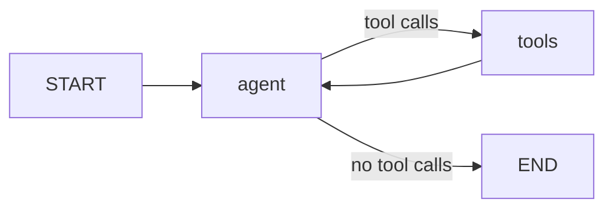

# Conditional Research Graph

A local research assistant built with [LangGraph](https://langchain-ai.github.io/langgraph/). The model either answers directly or calls a local evidence-search tool first, then produces its final answer.



## How it works

| Piece | Location | Role |
|-------|----------|------|
| `ResearchState` | `main.py` | State with one field, `messages`, typed `Annotated[list[AnyMessage], add_messages]`. The reducer appends node output to the existing history instead of replacing it. |
| `route_after_agent` | `main.py` | Returns `"tools"` if the latest message is an `AIMessage` with tool calls. Returns `"end"` otherwise, including for an empty history. |
| `build_graph` | `main.py` | Builds the `StateGraph`, registers nodes `"agent"` and `"tools"`, wires `START -> agent`, the conditional edge, and `tools -> agent`, then compiles. |
| `make_agent_node` | `main.py` | Factory for the model node. Uses a supplied `LLMClient`, or creates one. |
| `LLMClient` | `utils/llm_client.py` | Groq client that converts responses into LangChain `AIMessage` objects. |
| `SEARCH_TOOL_SCHEMA`, `search_evidence`, `tools_node` | `utils/local_tools.py` | Tool schema, a deterministic local evidence search, and the node that executes tool calls. |

### Message flow

For a question that needs evidence, the final history is, in order:

1. User message
2. Assistant message containing the tool call
3. Tool result (`ToolMessage`)
4. Final assistant answer

A direct answer ends after step 2 without running the tools node. An unknown tool name or invalid arguments produce a `ToolMessage` with an error payload (`unknown_tool` / `invalid_arguments`). Control still returns to the agent, which can respond safely.

## Project layout

```
main.py              State, router, graph builder, agent node factory
utils/llm_client.py  Groq-compatible model client
utils/local_tools.py Search schema, evidence search, tools node
test_graph.py        Offline tests using a mocked LLM client
requirements.txt     Pinned dependencies
```

## Setup

Requires Python 3.10+.

```powershell
python -m venv .venv
.venv\Scripts\Activate.ps1
pip install -r requirements.txt
```

## Configuration

| Variable | Required | Description |
|----------|----------|-------------|
| `GROQ_API_KEY` | Yes, for real model calls | Groq API key. |
| `GROQ_MODEL` | No | Model name. Defaults to `openai/gpt-oss-120b`. |

```powershell
$env:GROQ_API_KEY = "your-key"
```

## Usage

```python
from main import build_graph, make_agent_node
from utils.local_tools import tools_node

app = build_graph(make_agent_node(), tools_node)
result = app.invoke({"messages": [("user", "Why does my laptop battery drain fast?")]})
for message in result["messages"]:
    print(type(message).__name__, message.content)
```

## Testing

Tests inject a mocked `LLMClient`, so no API key or network access is needed.

```powershell
python -m pytest test_graph.py -q
```

They cover:

- routing for empty, plain-answer, and tool-call states
- a direct answer finishing without running the tools node
- the full agent -> tools -> agent cycle, including message order and history accumulation
- an unknown tool returning control to the agent

## Evidence data

`search_evidence` ranks a small built-in set of troubleshooting records (battery, heat, network) by token overlap with the query and returns up to two matches. Add records to `EVIDENCE_RECORDS` in `utils/local_tools.py` to extend it.
